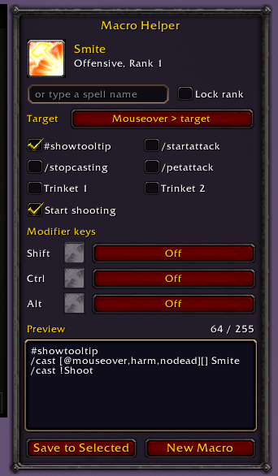

# Macro Helper

A World of Warcraft addon that builds macros for your abilities.

Works in **WoW Forever** and **Classic Era**.

## Install

**From a release:** Download the latest release from the [Releases](../../releases) page and extract it in your AddOns folder.

**Building the zip yourself:** run `./build.sh`. It creates `dist/MacroHelper-x.y.z.zip`, which you can install to the AddOns folder as above.

## Use

Open the macro window or type `/macrohelper`. Drag a spell or item onto the panel, pick the options you want, then click **New Macro** or **Save to Selected**.
